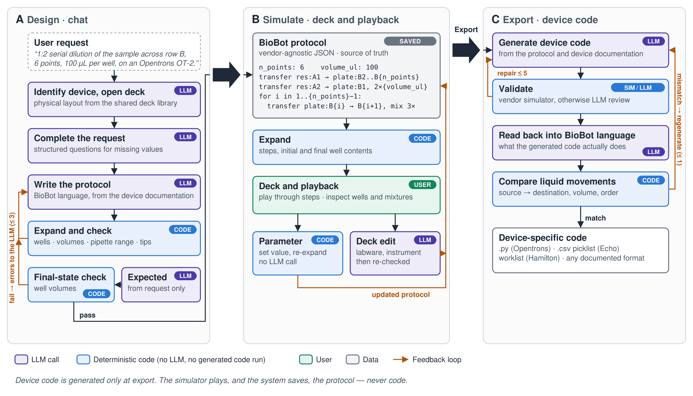

# BioBot protocol language

BioBot works in its own JSON protocol language, which isn't tied to any vendor. The LLM writes and edits
protocols in it; the simulator plays them; device code is generated from them only at
**Export code**. The authoritative specification given to the LLM is `LANGUAGE_SPEC` in
`biobot/protocol_lang.py`.

## Example — 1:2 serial dilution

```json
{
  "device": "Opentrons OT-2",
  "description": "1:2 serial dilution",
  "labware": [
    {"id": "plate", "position": "1", "identifier": "corning_96_wellplate_360ul_flat", "type": "plate", "rows": 8, "columns": 12, "max_volume_ul": 360},
    {"id": "res",   "position": "2", "identifier": "nest_12_reservoir_15ml", "type": "reservoir", "rows": 1, "columns": 12},
    {"id": "tips",  "position": "3", "identifier": "opentrons_96_tiprack_300ul", "type": "tiprack", "rows": 8, "columns": 12},
    {"id": "trash", "position": "12", "identifier": "opentrons_1_trash_1100ml_fixed", "type": "trash"}
  ],
  "instruments": [{"id": "p300", "model": "p300_single_gen2", "tips": ["tips"], "min_volume_ul": 20, "max_volume_ul": 300}],
  "liquids": [{"name": "diluent", "at": "res:A1", "volume_ul": 10000}, {"name": "sample", "at": "res:A2", "volume_ul": 2000}],
  "parameters": {"n_points": 6, "volume_ul": 100},
  "program": [
    {"transfer": {"from": "res:A1", "to": "plate:B2..B{n_points}", "volume": "{volume_ul}"}},
    {"transfer": {"from": "res:A2", "to": "plate:B1", "volume": "2*{volume_ul}"}},
    {"for": "i", "in": "1..{n_points}-1", "do": [
      {"transfer": {"from": "plate:B{i}", "to": "plate:B{i+1}", "volume": "{volume_ul}", "mix_after": 3}}
    ]}
  ]
}
```

## Instructions

| Instruction | Fields |
|---|---|
| `transfer` | `from`, `to` (wells), `volume`, optional `with`, `mix_after`, `new_tip` (`always`/`once`) |
| `mix` | `at`, `volume`, `repeats` |
| `incubate` | `at` (labware), `temperature_c`, `minutes` |
| `wait` | `minutes` |
| `move` | `labware`, `to` (position) |
| `device_op` | `name`, `description` — any documented operation not covered above |
| `for` | `"for": "i", "in": "a..b"` (inclusive), `do`: instructions |

Wells: `plate:A1`, `plate:A1,A2`, or a range along a row or a column (`plate:B2..B6`, `plate:A1..H1`).
`{expr}` inserts arithmetic (`+ - * / // %`) on parameters and loop variables. Volumes are in µL.

Tips are implicit. An instrument that declares `tips` picks up the next unused tip (racks in order,
column by column) for each transfer or mix, and drops it in the labware of type `trash`;
`"new_tip": "once"` keeps one tip for the whole instruction. Instruments without `tips`
(acoustic dispensers, for example) produce no tip steps.

## Expansion and checks

`expand()` turns a protocol into the simulator's steps with fixed code. No LLM is called, and
no generated code is executed: formulas go through an arithmetic-only evaluator. While
expanding, it tracks volume and composition in every well, and rejects:

- unknown labware, instruments, wells or deck positions;
- aspirating more than a well holds, or overflowing `max_volume_ul`;
- volumes outside the instrument's `min/max_volume_ul`, or not a multiple of its `volume_step_ul` (e.g. a droplet size);
- drawing a source well below its `dead_volume_ul`;
- programs needing more tips than are loaded.

Beyond these fields, a protocol declares the device's own specificities as open-ended `constraints`,
each a rule taken from the documentation and checked on every transfer, mix or well change, for example:

```json
"constraints": [
  {"applies_to": "transfer", "rule": "volume_ul / 0.0025 == round(volume_ul / 0.0025)", "message": "Volumes are multiples of the 2.5 nL droplet", "source": "…"},
  {"applies_to": "well", "rule": "type != 'plate' or well_volume_ul <= 65", "message": "Source wells hold at most 65 µL", "source": "…"}
]
```

Rules use numbers, strings, arithmetic, comparisons, `and`/`or`/`not`, `abs`, `round`, `min`, `max`, and
are evaluated without executing code. Nothing about any device is built into the language.

These limits come from the device documentation: when designing a protocol, BioBot also
searches the documentation for the device's specifications (volume range and resolution, well
working volume, dead volume) and the LLM must declare every documented limit.

## Workflow



**Figure — Simulator-centred workflow.** (A) *Design.* BioBot identifies the device and
opens its empty deck from the shared deck library, asks for missing values, and the LLM
writes the protocol in the BioBot language from the device documentation. Deterministic
code expands and checks it (wells, volumes, pipette range, tips), then compares its final
well volumes with an expected state that the LLM wrote from the request alone, without
seeing the program. Failures go back to the LLM (≤ 3 attempts). (B) *Simulate.* The saved
protocol is expanded into the deck and playback. A parameter change re-expands it instantly,
with no LLM call; other deck edits are applied by the LLM and re-checked. (C) *Export.* The
LLM generates device code, which is validated by the vendor simulator when one exists,
otherwise by LLM review (≤ 5 repairs). The code is then translated back into the BioBot
language, and its liquid movements must match the protocol's; if not, it is regenerated
once with the difference. Device code is generated only at export: the simulator plays,
and the system saves, the protocol.

Sources: `docs/protocol_workflow.svg` (editable), `.pdf` (vector) and `.png` (400 dpi),
171 mm wide (RSC double column). To regenerate: `python3 docs/make_protocol_workflow.py`
(needs `pip install cairosvg` for the PDF and PNG).

### Components

| Step | Where | LLM |
|---|---|---|
| Write the protocol, fix loop | `main_rag.design_protocol` | yes |
| Expected final state | `main_rag._expected_end_state` | yes, request only |
| Expand, physical checks, end-state comparison | `protocol_lang.expand`, `end_state_mismatches` | no |
| Deck contents for the simulator | `protocol_lang.binding` (via `deck_library.get_deck`) | no |
| Parameter change | `protocol_lang.set_parameters` (via `/deck/update`) | no |
| Other deck edits | `deck_visualizer.update_code_from_changes` | yes |
| Device code, validation | `main_rag.run_query_and_fix` (via `/protocol/export`) | yes |
| Read-back comparison | `main_rag.read_back_difference`, `protocol_lang.movements` | read-back only |
